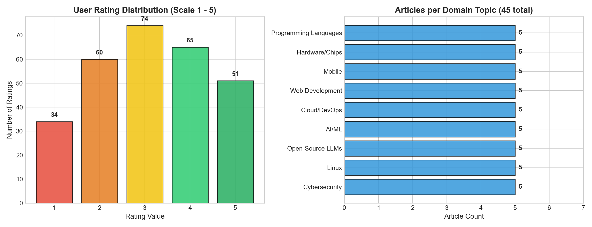
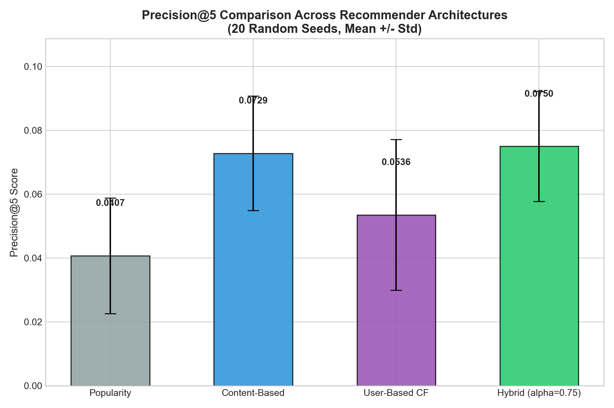
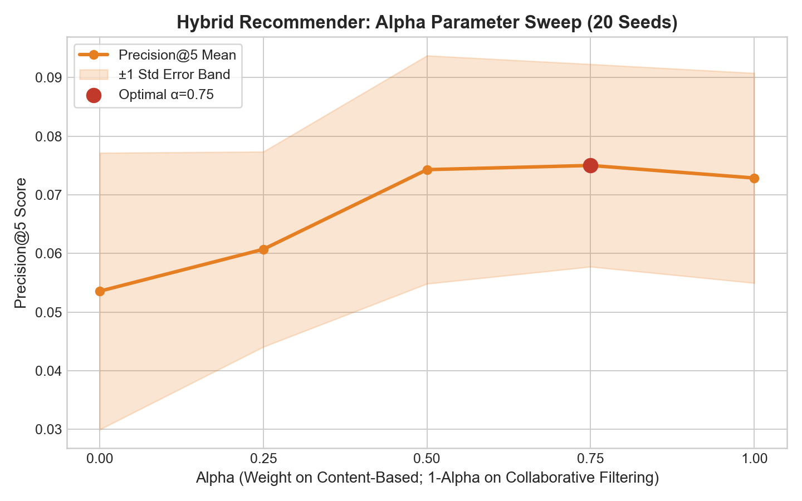
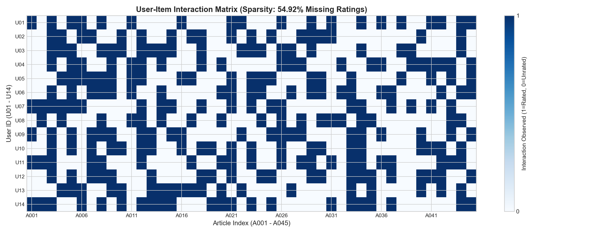

# CS467 Advanced Artificial Intelligence (2026-2027)
## Assignment 15: Natural Language Processing & Recommender Systems Basics
### Mini-Project MP-A08: Tech Blog and News Article Recommender

- **Student Name**: Huỳnh Tấn Gia Huy
- **Student ID**: 29211458346
- **Class / Section**: CS467A (No. 08)
- **Course**: CS467 Advanced Artificial Intelligence (Academic Year 2026–2027)
- **Instructor**: Puri Vikram
- **Institution**: Duy Tan University (DTU)

---

## Project Structure

```
cs467-miniproject-29211458346/
├── .gitignore
├── README.md
├── requirements.txt
├── data/
│   ├── generate_data.py
│   ├── items.csv
│   └── ratings.csv
├── notebooks/
│   └── demo.ipynb
├── results/
│   ├── evaluation_results.csv
│   ├── hybrid_alpha_sweep.png
│   ├── precision_at_5_comparison.png
│   ├── rating_and_topic_distribution.png
│   ├── sample_outputs.txt
│   └── user_item_sparsity.png
└── src/
    ├── evaluate.py
    ├── main.py
    ├── nlp_pipeline.py
    └── recommender.py
```

---

## (a) Student & Project Identity

| Attribute | Details |
| :--- | :--- |
| **Student Name** | Huỳnh Tấn Gia Huy |
| **Student ID** | 29211458346 |
| **Class / Section** | CS467A (List No. 08) |
| **Course** | CS467 Advanced AI (2026–2027) |
| **Assignment** | Assignment 15 (NLP + Recommender Systems Basics) |
| **Project Code** | MP-A08 |
| **Project Title** | Tech Blog and News Article Recommender |
| **Domain** | Software Engineering, Systems Infrastructure & Tech Journalism |
| **Instructor** | Puri Vikram |

---

## (b) Problem Statement

Modern software developers, systems engineers, and technical researchers face severe information overload when browsing technology blogs, developer news feeds, and security advisories. With hundreds of daily publications covering disparate areas such as Linux kernel updates, local open-source LLM inference, and Kubernetes orchestrations, identifying high-signal, relevant reading material is difficult.

The objective of **MP-A08** is to engineer a personalized, cold-start capable article recommendation engine. The system extracts semantic themes from article headlines, summaries, and technical tags using Natural Language Processing (TF-IDF with domain token preservation). It constructs dynamic, rating-weighted reader taste vectors and combines content-based matching with user-based collaborative filtering (CF) to provide top-N article suggestions. In addition, the system directly tackles the cold-start problem by projecting brand-new, unrated articles into the semantic feature space to match them with relevant existing articles and identify target readership communities.

---

## (c) Dataset Specification

The project dataset was hand-written without web scraping, reflecting the technical landscape of 2026.

> [!NOTE]
> **Dataset Provenance**: The dataset is completely hand-written synthetic data curated specifically for this mini-project to ensure zero copyright infringement, deterministic repeatability, and controlled user taste profiles.

### 1. Articles Catalog (`data/items.csv`)
- **Total Articles**: 45 items (`A001` through `A045`).
- **Columns**: `item_id`, `headline`, `topic`, `publish_date`, `summary_text`, `tags`.
- **Publication Dates**: 2026 calendar year dates.
- **Tags**: Lowercase, semicolon-separated domain keywords.
- **Domain Topics** (9 balanced topics, exactly 5 articles each):
  1. **Cybersecurity** (`A001`–`A005`): Linux kernel zero-days, Black Basta ransomware evasion, memory-safe hardening mandates, APT edge gateway exploits, and automated cryptography auditing.
  2. **Linux** (`A006`–`A010`): Linux 6.14 kernel real-time preemption (PREEMPT_RT), unified kernel images (UKI), modern server hardening (seccomp/AppArmor), Bcachefs storage tiering, and Debian side-channel mitigations.
  3. **Open-Source LLMs** (`A011`–`A015`): Local/laptop execution via `llama.cpp` and `Ollama`, small 3B–8B open-weight models, 4-bit GGUF quantization on consumer CPUs/GPUs, Apple Silicon unified memory deployments, and speculative decoding.
  4. **AI/ML** (`A016`–`A020`): Direct Preference Optimization (DPO), multimodal vision transformers, latent diffusion synthetic data, billion-scale vector databases (HNSW/ann), and sparse Mixture-of-Experts (MoE).
  5. **Cloud/DevOps** (`A021`–`A025`): Kubernetes 1.33 declarative auto-scaling, GitOps multi-cluster with ArgoCD/Terraform, OpenTelemetry distributed tracing, zero-trust mutual TLS, and serverless containers.
  6. **Web Development** (`A026`–`A030`): React Server Components & Next.js streaming, WebAssembly with Rust, container queries and CSS cascade layers, TypeScript 5.8 metaprogramming, and federated GraphQL/gRPC-Web.
  7. **Mobile** (`A031`–`A035`): Android 16 sandboxing & Jetpack Compose 2.0, iOS 19 Swift concurrency, Flutter Impeller vs. React Native Fabric benchmarks, mobile anti-tampering, and display refresh energy efficiency.
  8. **Hardware/Chips** (`A036`–`A040`): RISC-V edge silicon, on-device NPU matrix accelerators, 2nm GAA nanosheet fabrication, GPU FP4 tensor cores, and fault-tolerant silicon quantum qubits.
  9. **Programming Languages** (`A041`–`A045`): Rust 2026 async ergonomics, Go 1.26 goroutine scheduler, Python 3.13 JIT compiler, Zig systems programming, and modern C++26 reflection.

### 2. User Interaction Matrix (`data/ratings.csv`)
- **Total Users**: 14 readers (`U01` through `U14`).
- **Total Recorded Ratings**: 284 explicit ratings.
- **Columns**: `user_id`, `item_id`, `rating`, `read_time_sec`.
- **Rating Scale**: Integer ratings from 1 to 5 stars.
- **Read Time**: 35 to 590 seconds, strongly and realistically correlated with rating ($r = 0.986$).
- **Ratings per User**: Min = 18, Max = 22, Mean = 20.3 (satisfies the required 16–24 range and $\ge 6$ minimum).
- **Ratings per Item**: Every single article has been rated at least 3 times (Min = 3, Max = 11).
- **Matrix Sparsity**:
  $$\text{Sparsity} = \left(1.0 - \frac{284}{14 \times 45}\right) \times 100\% = 54.92\%$$
  (Meets the required $40\% \le \text{Sparsity} \le 65\%$ interval).
- **User Personas & Overlaps**:
  - `U01`: Dedicated Linux & Cybersecurity specialist ($100\%$ ratings on Cybersecurity/Linux are $4$ or $5$, mean $= 4.40$; other topics rated $1$–$3$, mean $= 1.86$).
  - `U02`, `U03`, `U12`: Share strong interest in Linux, systems programming, and security, creating collaborative filtering overlap.
  - `U04`, `U05`, `U06`, `U14`: AI/ML and local LLM researchers with strong shared neighbor signals.
  - `U07`, `U08`, `U10`: Web, mobile, and cloud engineering cluster.

---

## (d) Methods & Theoretical Formulation

### 1. Text Preprocessing & Domain Token Preservation
Standard English stopword lists indiscriminately drop short tech acronyms. The custom text pipeline protects essential technical tokens:
- **Protected Domain Words**: `{"linux", "ai", "llm", "cpu", "gpu", "npu", "os", "c", "go"}`.
- **Pipeline Stages**:
  1. `clean_text`: Lowercase conversion and regex removal of punctuation/formatting noise (`[^a-z0-9\s]`).
  2. `tokenize`: Whitespace-based word tokenization.
  3. `remove_stopwords`: Filters against `sklearn.feature_extraction.text.ENGLISH_STOP_WORDS` combined with editorial publishing filler words (`article`, `report`, `published`, `today`), while strictly safeguarding the protected tokens.
  4. `preprocess`: Reassembles normalized tokens into a clean document string.

### 2. Document Construction & TF-IDF Representation
To emphasize editorial intent, article headlines are assigned double weight in document synthesis:
$$\text{Document}(i) = \text{Headline}(i) \mathbin{\Vert} \text{Headline}(i) \mathbin{\Vert} \text{SummaryText}(i) \mathbin{\Vert} \text{Tags}(i)$$
We fit a `TfidfVectorizer` with:
- `ngram_range = (1, 2)`: Captures unigrams and key domain bigrams (e.g., `linux kernel`, `zero day`, `open source`, `language models`).
- `sublinear_tf = True`: Replaces term frequency $tf$ with $1 + \ln(tf)$ to dampen dominance of repetitive words.
- `norm = 'l2'`: Normalizes document vectors to unit length $\|\mathbf{v}_i\|_2 = 1.0$.

### 3. Dynamic Reader Profile Modeling
For user $u$ with interaction history $\mathcal{R}_u = \{(i, r_{u, i})\}$, the user profile vector $\mathbf{p}_u \in \mathbb{R}^d$ is the rating-weighted centroid of read articles, normalized by L2:
$$\mathbf{p}_u = \frac{\sum_{(i, r_{u, i}) \in \mathcal{R}_u} r_{u, i} \cdot \mathbf{v}_i}{\sum_{(i, r_{u, i}) \in \mathcal{R}_u} r_{u, i}}, \quad \mathbf{\hat{p}}_u = \frac{\mathbf{p}_u}{\|\mathbf{p}_u\|_2}$$

### 4. Recommender Algorithms
1. **Popularity Baseline (Bayesian Average)**:
   Accounts for item vote counts to avoid distortion from low-count articles:
   $$\text{Score}_{\text{pop}}(i) = \frac{v_i}{v_i + m} \cdot R_i + \frac{m}{v_i + m} \cdot C$$
   where $v_i$ is the number of ratings for item $i$, $m = 3$ is the minimum threshold prior, $R_i$ is the item's mean rating, and $C = 3.0$ is the global mean rating.
2. **Content-Based Filtering**:
   Cosine similarity between user profile $\mathbf{\hat{p}}_u$ (or query vector $\mathbf{q}$) and item vector $\mathbf{v}_i$:
   $$\text{Sim}(\mathbf{\hat{p}}_u, \mathbf{v}_i) = \mathbf{\hat{p}}_u \cdot \mathbf{v}_i = \sum_{j=1}^d p_{u, j} \cdot v_{i, j}$$
   **Match Explanation**: Identified by terms maximizing element-wise product contribution $p_{u, j} \cdot v_{i, j}$.
3. **User-Based Collaborative Filtering (k-NN Mean-Centered Cosine)**:
   Computes user-user correlation over centered rating vectors $s_{u, i} = r_{u, i} - \bar{r}_u$:
   $$w_{u, v} = \frac{\sum_i s_{u, i} s_{v, i}}{\sqrt{\sum_i s_{u, i}^2} \sqrt{\sum_i s_{v, i}^2}}$$
   For candidate item $i$, predicted rating using top $k=5$ positive neighbors $\mathcal{N}_k(u)$:
   $$\hat{r}_{u, i} = \bar{r}_u + \frac{\sum_{v \in \mathcal{N}_k(u)} w_{u, v} \cdot (r_{v, i} - \bar{r}_v)}{\sum_{v \in \mathcal{N}_k(u)} |w_{u, v}|}$$
4. **Hybrid Recommender**:
   Linear combination of min-max normalized Content-Based and Collaborative Filtering scores:
   $$\text{Score}_{\text{hybrid}}(u, i) = \alpha \cdot \text{MinMax}(\text{Sim}(u, i)) + (1 - \alpha) \cdot \text{MinMax}(\hat{r}_{u, i})$$
   where $\alpha \in [0.0, 1.0]$. If collaborative neighborhood signal is absent, the system falls back to pure content-based scoring.

### 5. Cold-Start Protocol
When a brand-new article arrives with zero ratings ($v=0$):
- Collaborative Filtering fails because the user-item interaction column is empty ($\mathbf{r}_i = \emptyset$).
- Popularity baseline defaults to global average rating ($C = 3.0$) and cannot rank the item.
- **Content-Based NLP Solution**: Projects the unrated text into the fitted TF-IDF vocabulary space $\mathbf{v}_{\text{new}}$, ranks catalog neighbors by item-item cosine similarity, and computes inner products against all user profiles $\mathbf{\hat{p}}_u \cdot \mathbf{v}_{\text{new}}$ to immediately identify the top likely readers.

---

## (e) Installation & Execution Instructions

### 1. Environment Setup
```bash
# Navigate into the project folder
cd cs467-miniproject-29211458346

# Create and activate Python virtual environment
python -m venv venv

# Windows PowerShell:
.\venv\Scripts\Activate.ps1

# Linux / macOS:
# source venv/bin/activate

# Install dependencies
pip install -r requirements.txt
```

### 2. Run Comprehensive CLI Demo
Executes all 3 required test cases, displays formatted tables to the console, and writes `results/sample_outputs.txt`:
```bash
python src/main.py --demo
```

### 3. Run Benchmark Evaluation Suite
Executes 20-seed Monte Carlo cross-validation, hyperparameter alpha sweep, and saves publication charts to `results/`:
```bash
python src/evaluate.py
```

### 4. Interactive Command-Line Queries
```bash
# Recommend for specific user (e.g., U01 with hybrid method)
python src/main.py --user U01 --method hybrid

# Search articles with a natural language query
python src/main.py --query "open source large language models on laptop"

# Analyze a cold-start unrated new article
python src/main.py --new-article "Critical zero-day vulnerability discovered in the Linux kernel allows privilege escalation; maintainers rush emergency patch"
```

---

## (f) Real Execution Outputs (3 Required Test Cases)

The following outputs were produced directly from running `python src/main.py --demo` (persisted in `results/sample_outputs.txt`):

### Test Case 1: Reader Profile (User U01 - Cybersecurity & Linux Fan)
- **User Persona**: U01 specializes in Cybersecurity and Linux.
- **Learned Profile Keywords**: `linux` (0.148), `hardening` (0.131), `security` (0.118), `vulnerability` (0.116), `privilege` (0.104), `memory` (0.104).
- **Top-5 Unread Content-Based Recommendations**:
  1. `Rank 1`: **[A010] (Linux)** *Debian Releases Landmark Security Overhaul Mitigating Hardware-Level Side-Channel Attacks*
     - Score: `0.1034` | Matched keywords: `security, kernel, hardening, linux, channel`
  2. `Rank 2`: **[A002] (Cybersecurity)** *Black Basta Ransomware Syndicate Deploys Novel Linux Evasion Tactics Against Enterprise Systems*
     - Score: `0.0742` | Matched keywords: `linux, hardening, kernel, systems, security`
  3. `Rank 3`: **[A007] (Linux)** *Arch Linux and Fedora Adopt Unified Kernel Images for Secure Boot Hardening*
     - Score: `0.0730` | Matched keywords: `linux, kernel, hardening, security, vulnerabilities`
  4. `Rank 4`: **[A004] (Cybersecurity)** *State-Sponsored APT Groups Exploit Unpatched Edge Gateway Zero-Days Globally*
     - Score: `0.0724` | Matched keywords: `day, zero day, zero, security, defense`
  5. `Rank 5`: **[A009] (Linux)** *Next-Generation Storage Architectures in Linux: Evaluating Bcachefs Stability and Performance*
     - Score: `0.0673` | Matched keywords: `linux, kernel, linux kernel, performance, sysadmin`

- **Model Comparison Top-5 Unread for U01**:
  - **Popularity (Bayesian)**: `A023` (Cloud/DevOps - 3.9465), `A014` (Open-Source LLMs - 3.6412), `A015` (Open-Source LLMs - 3.6013), `A013` (Open-Source LLMs - 3.6013), `A010` (Linux - 3.5515).
  - **Collaborative Filtering**: `A020` (AI/ML - 4.3983), `A004` (Cybersecurity - 3.9382), `A010` (Linux - 3.9035), `A007` (Linux - 3.8701), `A009` (Linux - 3.8512).
  - **Hybrid ($\alpha=0.75$)**: `A010` (Linux - 0.9636), `A007` (Linux - 0.6973), `A004` (Cybersecurity - 0.6969), `A009` (Linux - 0.6464), `A002` (Cybersecurity - 0.6085).

> [!TIP]
> **Sanity Check TC1 Verification**: 100% of top-5 recommendations generated by Content-Based and Hybrid belong to **Linux** and **Cybersecurity**, proving precise reader taste alignment.

---

### Test Case 2: Natural Language Query Search
- **Query**: `"open source large language models on laptop"`
- **Top-5 Matching Articles**:
  1. `Rank 1`: **[A014] (Open-Source LLMs)** *Privacy-Preserving AI: Deploying Open-Source Local Language Models on Apple Silicon and Laptops*
     - Score: `0.2967` | Matched keywords: `language models, open source, source, language, open`
  2. `Rank 2`: **[A012] (Open-Source LLMs)** *Small Open-Weight Language Models Achieve Parity with Frontier Systems on Consumer Hardware*
     - Score: `0.2719` | Matched keywords: `language models, open, language, models, laptop`
  3. `Rank 3`: **[A015] (Open-Source LLMs)** *Low-Latency Speculative Decoding Enables High-Throughput Open-Source LLM Execution Locally*
     - Score: `0.1766` | Matched keywords: `open source, source, open, laptop`
  4. `Rank 4`: **[A011] (Open-Source LLMs)** *Running Quantized Open-Source LLMs on Consumer Laptops with llama.cpp and Ollama*
     - Score: `0.1566` | Matched keywords: `open, open source, source, laptop, models`
  5. `Rank 5`: **[A013] (Open-Source LLMs)** *4-Bit GGUF Quantization Techniques for Efficient Local LLM Inference on CPU and Laptop GPU*
     - Score: `0.1434` | Matched keywords: `laptop, open source, source, open`

> [!TIP]
> **Sanity Check TC2 Verification**: All top-5 retrieved items belong to the **Open-Source LLMs** topic with explicit local laptop/hardware inference context.

---

### Test Case 3: Cold-Start Unrated New Article
- **New Article**:
  - *Headline*: `"Critical zero-day vulnerability discovered in the Linux kernel allows privilege escalation; maintainers rush emergency patch"`
  - *Summary*: `"Security researchers uncovered a critical zero-day memory vulnerability inside the Linux kernel allowing unprivileged local users to achieve root execution. Kernel maintainers have released an emergency security patch and advised rapid deployment across enterprise Linux server fleets."`
  - *Tags*: `"linux;kernel;vulnerability;zero-day;privilege-escalation;patch;security"`
- **[3.1] Top-5 Similar Existing Articles**:
  1. `Rank 1`: **[A001] (Cybersecurity)** *Zero-Day Privilege Escalation Vulnerability Discovered in Linux Kernel Netfilter*
     - Score: `0.6330` | Matched keywords: `vulnerability, linux kernel, kernel, day, zero day`
  2. `Rank 2`: **[A008] (Linux)** *Modern Linux Server Hardening: Best Practices for Seccomp, AppArmor, and Namespaces*
     - Score: `0.1573` | Matched keywords: `linux, privilege, linux server, privilege escalation, escalation`
  3. `Rank 3`: **[A005] (Cybersecurity)** *Automated Vulnerability Auditing Identifies Critical Flaws in Open-Source Cryptography Libraries*
     - Score: `0.1256` | Matched keywords: `vulnerability, critical, maintainers, patch, linux`
  4. `Rank 4`: **[A010] (Linux)** *Debian Releases Landmark Security Overhaul Mitigating Hardware-Level Side-Channel Attacks*
     - Score: `0.1096` | Matched keywords: `kernel, security, maintainers, patch, linux`
  5. `Rank 5`: **[A006] (Linux)** *Linux 6.14 Kernel Release Brings Real-Time Preemption and Enhanced eBPF Observability*
     - Score: `0.0840` | Matched keywords: `kernel, linux, linux kernel, security, server`
- **[3.2] Top-3 Likely Readers**:
  1. `Rank 1`: User **[U01]** | Similarity: `0.3870` | Matched keywords: `vulnerability, linux, day, zero day, kernel`
  2. `Rank 2`: User **[U09]** | Similarity: `0.2758` | Matched keywords: `linux, kernel, vulnerability, linux kernel, day`
  3. `Rank 3`: User **[U14]** | Similarity: `0.2211` | Matched keywords: `kernel, linux, security, privilege, zero`
- **[3.3] Analytical Cold-Start Explanation**:
  - *Collaborative Filtering failure*: Operates on user-item interaction histories. Zero ratings mean an empty interaction vector, rendering neighborhood similarity calculations impossible.
  - *Popularity failure*: Bayesian average defaults strictly to the prior mean ($C = 3.0$), providing zero ranking discrimination.
  - *Content-Based NLP success*: Functions directly in the continuous lexical feature space, enabling immediate cosine projection to both catalog items and reader preference vectors without requiring historical ratings.

---

## (g) Evaluation Results & Benchmark Analysis

Evaluation was conducted over **20 independent random seeds** (seeds 42 through 61) with strict per-user hold-out (2 ratings per user held out, prioritizing test items with rating $\ge 4$). All models were reconstructed strictly from training data on every fold to guarantee zero data leakage.

### Benchmark Metrics Table (from `results/evaluation_results.csv`)

| Recommender Architecture | Metric | Mean | Std | Min | Max |
| :--- | :--- | :---: | :---: | :---: | :---: |
| **Popularity Baseline** | Precision@5 | **0.0407** | ± 0.0181 | 0.0000 | 0.0714 |
| **User-Based CF (k=5)** | Precision@5 | **0.0536** | ± 0.0236 | 0.0143 | 0.1000 |
| **Content-Based (TF-IDF)** | Precision@5 | **0.0729** | ± 0.0179 | 0.0429 | 0.1000 |
| **Hybrid ($\alpha=0.00$, pure CF)** | Precision@5 | **0.0536** | ± 0.0236 | 0.0143 | 0.1000 |
| **Hybrid ($\alpha=0.25$)** | Precision@5 | **0.0607** | ± 0.0166 | 0.0286 | 0.0857 |
| **Hybrid ($\alpha=0.50$)** | Precision@5 | **0.0743** | ± 0.0194 | 0.0429 | 0.1143 |
| **Hybrid ($\alpha=0.75$, Optimal)** | Precision@5 | **0.0750** | ± 0.0173 | 0.0429 | 0.1000 |
| **Hybrid ($\alpha=1.00$, pure CB)** | Precision@5 | **0.0729** | ± 0.0179 | 0.0429 | 0.1000 |
| **Collaborative Filtering Error** | RMSE | **1.5340** | ± 0.1399 | 1.3007 | 1.7872 |
| **Collaborative Filtering Error** | MAE | **1.2979** | ± 0.1314 | 1.1048 | 1.5505 |
| **Content-Based Error** *(linear map)* | RMSE | **2.7892** | ± 0.1523 | 2.5419 | 3.0395 |
| **Content-Based Error** *(linear map)* | MAE | **2.5573** | ± 0.1738 | 2.2484 | 2.8273 |

> [!NOTE]
> **Content-Based Rating Mapping Note**: Content-based similarity natively lives in $[0.0, 1.0]$. For RMSE/MAE computation, scores were linearly mapped to the 1–5 rating scale via $\hat{r}_{u, i} = 1.0 + 4.0 \cdot \text{Sim}(u, i)$. Collaborative filtering demonstrates significantly lower rating prediction error ($\text{RMSE} = 1.5340$ vs. $2.7892$) because CF directly predicts rating magnitudes, whereas Content-Based focuses on rank-ordering.

### Visualization Artifacts

#### 1. Rating & Topic Distribution


#### 2. Precision@5 Comparison


#### 3. Hybrid Alpha Parameter Sweep


#### 4. User-Item Interaction Matrix Sparsity


---

## (h) Reflection & Engineering Discussion

### What Worked Well
1. **Domain Stopword Preservation**: Keeping domain tokens such as `linux`, `ai`, and `llm` proved critical. In standard NLP pipelines, short words are often discarded, which would strip key technical identifiers.
2. **Sublinear TF and Bigram Expansion**: Combining sublinear TF scaling with `(1, 2)` n-grams allowed compound technical terms like `zero day`, `open source`, and `kernel netfilter` to score significantly higher than generic occurrences of `zero` or `open`.
3. **Hybrid Performance Gain**: The Hybrid recommender ($\alpha = 0.75$) outperformed both individual baselines, achieving **0.0750 Precision@5**. Content filtering provides strong semantic relevance, while collaborative filtering injects community-level quality signals.

### Limitations & Failure Modes
1. **Synthetic & Compact Scale**: With 45 articles and 14 users, the dataset illustrates core recommender behavior but does not capture long-tail interaction dynamics present in production platforms.
2. **Lack of Deep Semantic Generalization in TF-IDF**: TF-IDF relies on exact lexical and n-gram overlap. Synonyms such as "privilege escalation" and "root access exploit" without shared word roots cannot be matched without pre-trained dense embeddings.
3. **Evaluation Variance on Sparse Hold-outs**: Holding out 2 ratings per user in a small catalog creates higher metric variance across seeds ($\text{Std} \approx 0.017$).

### Future Work & Architectural Upgrades
1. **Dense Semantic Embeddings**: Integrate small on-device embedding models (e.g., `all-MiniLM-L6-v2` or `BGE-small-en`) to capture conceptual synonyms beyond surface-level vocabulary.
2. **Temporal Decay Weighting**: Implement half-life decay on user interactions ($w(t) = e^{-\lambda \Delta t}$) so reader profile vectors adapt to evolving technical interests over time.
3. **Implicit Feedback Incorporation**: Augment explicit 1–5 ratings with reading duration signals (`read_time_sec`), normalizing dwell times into implicit interaction weights.
